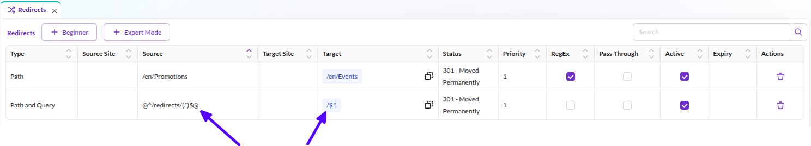
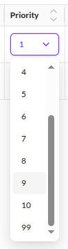
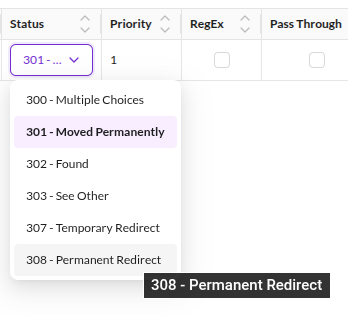

# URLs Based on Redirects
:::caution

To use this feature, please enable the `PimcoreSeoBundle` in your `bundle.php` file and install it accordingly with the following command:

`bin/console pimcore:bundle:install PimcoreSeoBundle`

:::

## Introduction
Redirects are a useful feature of Pimcore for directing the user to the correct pages - may it be for marketing URLs, 
 for redirects after a website relaunch or redirects for moved Documents. 
 
Depending on their priority, Redirects come second (priority 99) or sixth (all other priorities) in the route processing priority.  


## Setting up Redirects
Redirects are configured in the Redirects editor, accessible via the Tools menu. 

#### Regular Expression and Back-Reference Syntax

You can use regular expressions to define the sources, the placeholders in the regex can be accessed in the target 
URL using the PCRE back-reference syntax. 

<div class="image-as-lightbox"></div>



Notice: Only simple `$1-n` references are possible, no special back-reference syntax. 


#### Priority

Each redirect has a priority.

<div class="image-as-lightbox"></div>


 
* 99 (override all): Redirects with priority 99 come second in route processing and therefore overwrite document paths and custom routes. 
* 1 (lowest) - 10 (highest): Redirects with priority 1 to 10 come fifth in route processing and are processed after document paths and custom routes. 


#### Creating Redirects When Moving or Renaming Documents
Pimcore provides the ability to automatically create Redirects when renaming and moving Documents (in terms of SEO and user experience). 

```yaml
pimcore_seo:
    redirects:
        auto_create_redirects: true
```

With the setting enabled, moving or renaming a document, or moving a folder, creates a redirect from the former path for the
page or hardlink and for every document below it (folders excluded). This applies to every way of moving, including Pimcore Studio,
the PHP API, console commands and background jobs. A user needs the `redirects` permission for the redirects to be created;
moves without a user (console, background jobs) only depend on the setting. A redirect that cannot be saved is logged and
does not stop the move.


#### Creating custom redirect status codes
The redirect status codes list can be extended by adding custom codes in config.yaml:

```yaml
pimcore_seo:
    redirects:
        status_codes:
            308: Permanent Redirect
```


The new status codes can be seen in Pimcore Studio.

<div class="image-as-lightbox"></div>


