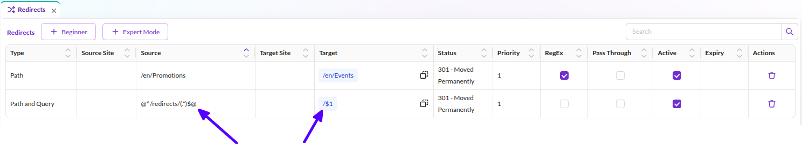
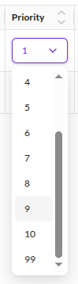
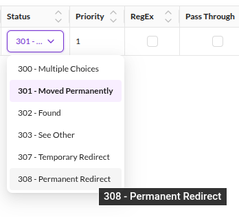

# URLs Based on Redirects
:::caution

To use this feature, please enable the `PimcoreSeoBundle` in your `bundle.php` file and install it accordingly with the following command:

`bin/console pimcore:bundle:install PimcoreSeoBundle`

:::

## Introduction
Redirects are a useful feature of Pimcore for directing the user to the correct pages - may it be for marketing URLs, 
 for redirects after a website relaunch or redirects for moved Documents. 
 
Depending on their priority, Redirects come second (priority 99) or sixth (all other priorities) in the route processing priority.  


## Setting up Redirects
Redirects are configured in the Redirects editor, accessible via the Tools menu. 

#### Regular Expression and Back-Reference Syntax

You can use regular expressions to define the sources, the placeholders in the regex can be accessed in the target 
URL using the PCRE back-reference syntax. 

<div class="image-as-lightbox"></div>



Notice: Only simple `$1-n` references are possible, no special back-reference syntax. 


#### Redirect Targets

A target can be an external URL, a path, or a Pimcore element. Elements are referenced by their
ID together with a target type, which can be a `document`, an `asset` or an `object`:

* `document`: the redirect points to the full path of a Page, Link or Hardlink.
* `asset`: the redirect points to the full path of the Asset.
* `object`: the redirect points to the URL generated by the
  [link generator](../../03_Objects/01_Object_Classes/04_Additional_Class_Settings/06_Link_Generator.md)
  of the Data Object's class. Data Objects without a link generator cannot be used as a target.

In Pimcore Studio the target type is set in the redirects grid, and dropping an element onto the
target column fills in both the target and its type. Redirects that store a numeric target without
a target type - for example those created automatically when a Document is moved - are resolved as
Documents.

#### Priority

Each redirect has a priority.

<div class="image-as-lightbox"></div>


 
* 99 (override all): Redirects with priority 99 come second in route processing and therefore overwrite document paths and custom routes. 
* 1 (lowest) - 10 (highest): Redirects with priority 1 to 10 come fifth in route processing and are processed after document paths and custom routes. 


#### Creating Redirects When Moving or Renaming Documents
Pimcore provides the ability to automatically create Redirects when renaming and moving Documents (in terms of SEO and user experience). 

```yaml
pimcore_seo:
    redirects:
        auto_create_redirects: true
```


#### Creating custom redirect status codes
The redirect status codes list can be extended by adding custom codes in config.yaml:

```yaml
pimcore_seo:
    redirects:
        status_codes:
            308: Permanent Redirect
```


The new status codes can be seen in Pimcore Studio.

<div class="image-as-lightbox"></div>


