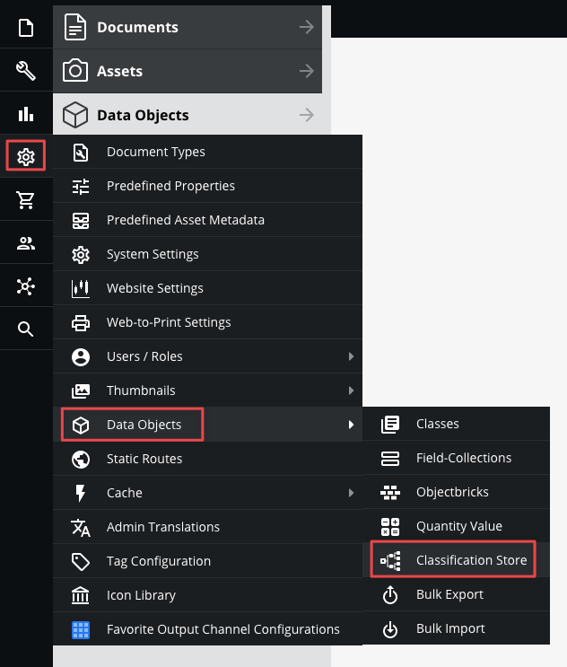
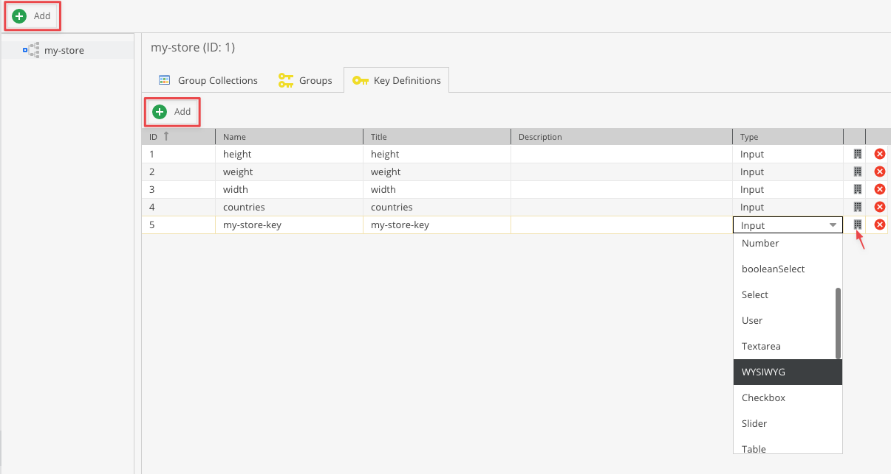
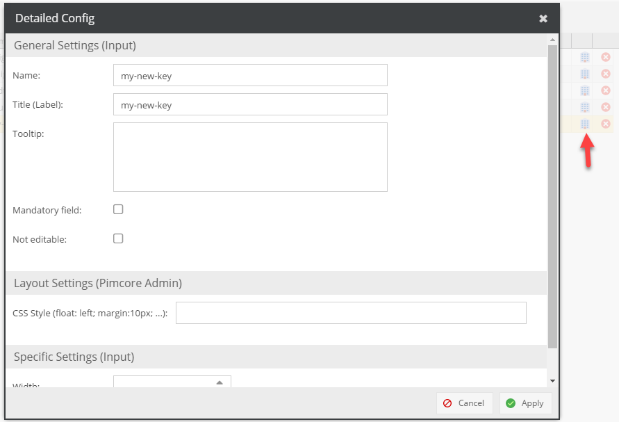
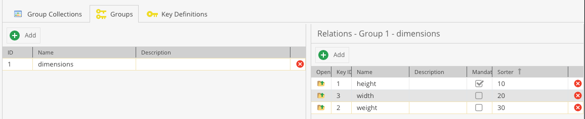
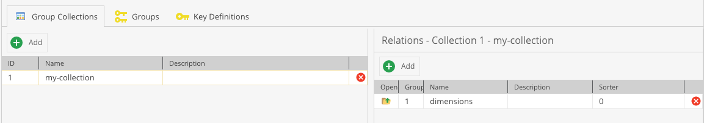
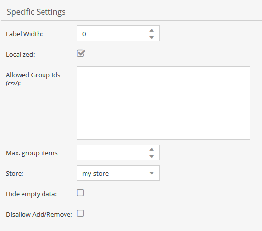
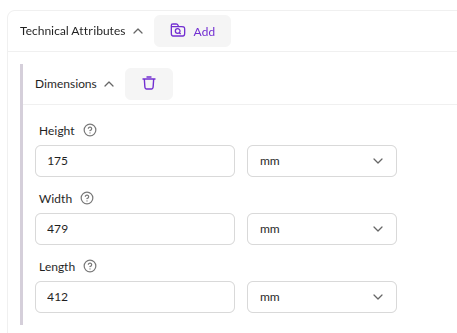
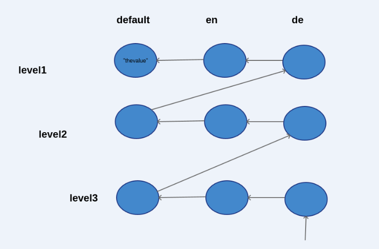

# Classification Store

## Overview

The classification store has quite some similarities to a key/value-like datatype. 

A key/value data type allows to add an arbitrary number of key/value pairs to objects with the restriction that each 
key can only be added once to that object.

#### The most important facts:
* There can be multiple store with completely isolated feature sets.
* Inheritance is supported.
* An object can have more than one classification store.
* Localization is supported (optionally, can be configured in the class definition).
* The classification store introduces the concept of a fallback language.
* All simple data types (e.g. textarea, date, etc are supported). The store can be extended with custom data types.
* Takes advantage of the built-in mechanism for the field definition + data editing (validation, etc).
* Keys can be organized in groups.
* A key can belong to several groups.
* Individual keys currently cannot be added to the object. Instead, the corresponding groups added.
* The allowed groups can be restricted via the class definition.


## Configuration of Classification Stores

Before using the classification store, at least one classification store with collections, groups and keys has to be
defined. 

### Key definition
* Go to classification store in Objects menu:



* Add a new store if necessary
* Add a key
* Select type



* Click on the configuration button on the right for detailed settings
* Note that not all settings are respected (e.g. `indexed`)




### Group definition and key assignment
* Use the group editor to define and organize keys into groups
* Similar to keys a sort order can be specified
* Groups with lower sort order are displayed first
* A key can belong to more than one group
* It is not necessary for the group name to be unique. Note that two entities of the same kind sharing a name within
  one store cannot both be resolved by the identifier backfill described under [Identifiers](#identifiers) - it leaves
  both of them without an identifier and reports them for an operator to resolve
* Use the grid on the right side to manage the keys belonging to the selected group
* Configure sort order for the object editor, keys with lower values are listed first
* Configure which keys should be mandatory in this group



### Collection definition

* Groups can optionally be organized into collections
* A collection is simply a container which allows to add several groups at once, there is no actual logic behind it




## Class definition

* Localization can be enabled, by default only the `default` language is available
* Allowed groups can be restricted by providing a comma-separated list of group ids
* There can be more than one classification store field 
* Configure the group sort order for the object editor, groups with lower values are listed first
* Optionally you can decide whether you want to see all keys or just the non-empty ones.
* Optionally you can disable add/remove of groups in object editor (in this case, groups can only added and removed via API)
* Optionally you can define a limit of how many groups can be used




## Object editor

* Groups can be added/removed via the add/remove buttons (see screenshot below)
* Keys are displayed in the specified sort order. If the order is equal then the keys are sorted by creation date




## Inheritance

In contrast to localized fields fallback and inherited values are first resolved in a horizontal way. 
If no value can be found on the same level, the parent level is scanned in the same language order. 
As mentioned before, there is the concept of a `default` language which is just an additional pseudo language 
which acts as the last resort.

Consider the following example and let’s assume that English is the fallback language for German. 
We request the German value for the object at level 3. 
Since the only value can be found on level 1 for the default language the tree is traversed as depicted.



## Using Classification Store via PHP API

```php
// setter, group id = 1, key id id = 2, language = de

// the value is of type "quantity value" where 1 is the unit ID in this example
$heightValue = new \Pimcore\Model\DataObject\Data\QuantityValue(13, 1);
$object->getClassificationStore2()->setLocalizedKeyValue(1, 2, $heightValue, "de");
// 1 = group id
$object->getClassificationStore2()->setActiveGroups([1 => true]);
  
// provide additional information about which collection the group belongs to
// group 1 belongs to collection with ID 2
$object->getClassificationStore2()->setGroupCollectionMapping(1, 2);
  
// retrieve the mapping 
// this will return 2 => collection with ID 2
$object->getClassificationStore2()->getGroupCollectionMapping(1);
  
// getter, group id = 1, key id id = 2, language = de
$value = $object->getClassificationStore2()->getLocalizedKeyValue(1, 2, "de");
  
// get the list of active groups
$store = $object->getClassificationStore2();
$groups = $store->getActiveGroups();
  
// get all values as associative array [groupId][keyid][language] => value
$allValues = $store->getItems();
   
```

### Retrieving group and key data

The `ClassificationStore::getGroups()` method returns an array of `Group` objects. In turn, the `Group::getKeys()` method returns an array of `Key` objects for that group.

```php
/** @var \Pimcore\Model\DataObject\Classificationstore $classificationStore */
$classificationStore = $dataObject->get<YOUR_CLASSIFICATION_FIELD>();

foreach ($classificationStore->getGroups() as $group) {
    var_dump($group->getConfiguration()->getName());

    foreach ($group->getKeys() as $key) {
        $keyConfiguration = $key->getConfiguration();

        $value = $key->getValue();
        if ($value instanceof \Pimcore\Model\DataObject\Data\QuantityValue) {
            $value = (string)$value;
        }

        var_dump([
            $keyConfiguration->getId(),
            $keyConfiguration->getType(),
            $keyConfiguration->getName(),
            $keyConfiguration->getTitle(),
            $value,
            ($key->getFieldDefinition() instanceof QuantityValue),
        ]);
    }
}
```

The `Key::getValue()` method supports the `language`, `ignoreFallbackLanguage` and `ignoreDefaultLanguage` arguments.

```php
/** @var \Pimcore\Model\DataObject\Classificationstore\Key $key */
$key->getValue('en_GB', true, true);
```


### Adding new items to Classification Store through code

```php

// KeyConfig

// first of all, define the datatype which is quantity value in this example
$definition = new \Pimcore\Model\DataObject\ClassDefinition\Data\QuantityValue();
$definition->setName("height");
$definition->setTitle("Height");

$keyConfig = new \Pimcore\Model\DataObject\Classificationstore\KeyConfig();
$keyConfig->setStoreId($storeId);
$keyConfig->setName($name);
$keyConfig->setDescription($description);
$keyConfig->setEnabled(true);
$keyConfig->setType($definition->getFieldtype());
$keyConfig->setDefinition(json_encode($definition)); // The definition is used in object editor to render fields
$keyConfig->save();  

// Group
$groupConfig = new \Pimcore\Model\DataObject\Classificationstore\GroupConfig();
$groupConfig->setStoreId($storeId);
$groupConfig->setName($name);
$groupConfig->setDescription($description);
$groupConfig->save();

// Collection
$collectionConfig = new \Pimcore\Model\DataObject\Classificationstore\CollectionConfig();
$collectionConfig->setStoreId($storeId);
$collectionConfig->setName($name);
$collectionConfig->setDescription($description);
$collectionConfig->save();

// Add a key to group
$keyRel = new \Pimcore\Model\DataObject\Classificationstore\KeyGroupRelation();
$keyRel->setGroupId($groupConfig->getId());
$keyRel->setKeyId($keyConfig->getId());
$keyRel->save();

// Add a group to a collection
$groupRel = new \Pimcore\Model\DataObject\Classificationstore\CollectionGroupRelation();
$groupRel->setGroupId($groupConfig->getId());
$groupRel->setColId($collectionConfig->getId());
$groupRel->save();
```

### Identifiers

Stores, collections, groups and keys carry an `identifier` in addition to their auto increment id and their name.
It is meant as the stable handle for an entity across environments, where the auto increment id is not comparable
and the name is not unique.

* It is **generated** when an entity is created and does not derive from the entity's name, so it stays stable when
  the name is edited. Setting an identifier explicitly before the first `save()` keeps that value instead.
* It is **opaque** - do not parse it, and do not expect it to be readable.
* It is **immutable**: once an entity holds a non-null identifier, `setIdentifier()` refuses to change it and throws
  `Pimcore\Model\Exception\InvalidConfigException`. Setting the same value again is a no-op.
* It is **unique per store** for collections, groups and keys, and unique overall for stores. A save that would write
  an identifier which is already in use within that scope is refused with the same exception, and nothing is written -
  the identifier is never disambiguated with a suffix.
* Valid identifiers match `/^[A-Za-z0-9][A-Za-z0-9_-]*$/` and are at most 190 characters long. Anything else is
  rejected by `setIdentifier()`.

```php
$keyConfig = \Pimcore\Model\DataObject\Classificationstore\KeyConfig::getByIdentifier($identifier, $storeId);
$groupConfig = \Pimcore\Model\DataObject\Classificationstore\GroupConfig::getByIdentifier($identifier, $storeId);
$collectionConfig = \Pimcore\Model\DataObject\Classificationstore\CollectionConfig::getByIdentifier($identifier, $storeId);
$storeConfig = \Pimcore\Model\DataObject\Classificationstore\StoreConfig::getByIdentifier($identifier);
```

Each of them returns `null` when nothing matches.

#### Backfilling existing rows

Rows that already existed before the identifier was introduced have none. The console command

```bash
bin/console pimcore:classificationstore:backfill-identifiers
```

assigns an identifier derived from the entity's name to every row across the four tables whose identifier is still
`NULL`, disabled keys included. It writes the `identifier` column and nothing else - no title, modification date or
definition is rewritten - and it is idempotent, so running it twice changes nothing.

A pre-flight runs before anything is written. Rows for which no unique identifier can be derived from the name are
left untouched, listed in the command's report with their type, id, name and the reason, and the command still exits
with `0`. That happens when two entities of the same kind share a name within one store, when the derived identifier
is already taken, or when the name contains no characters a valid identifier can be built from. Those rows keep a
`NULL` identifier until someone renames them and runs the command again.
