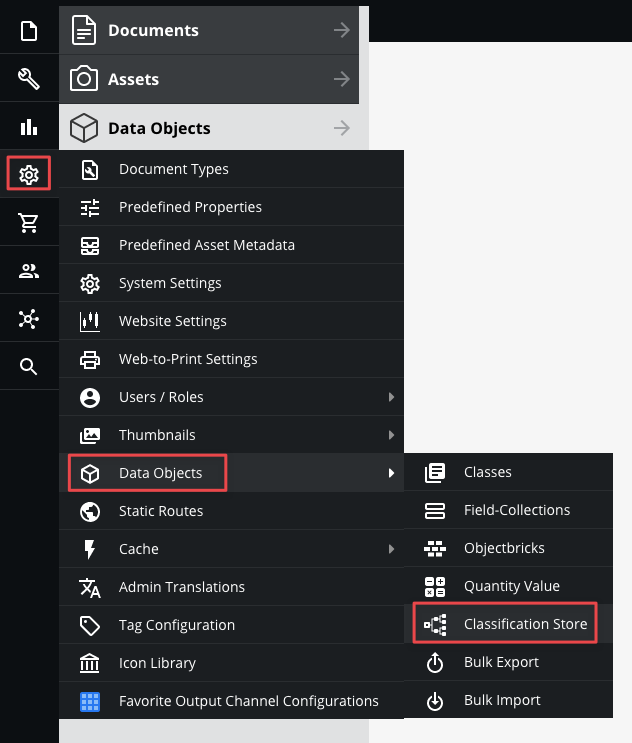
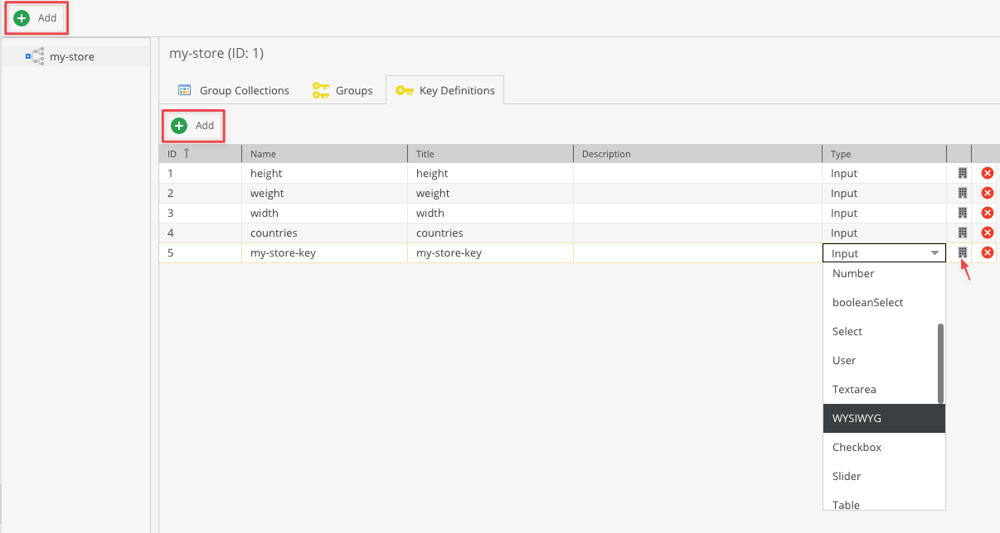
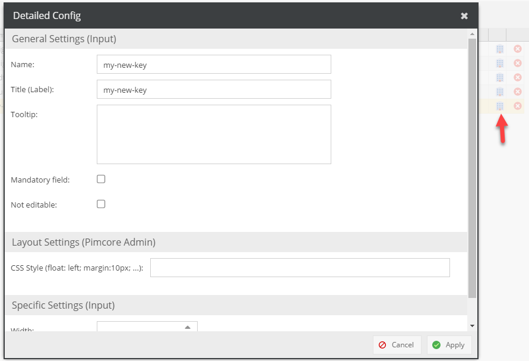
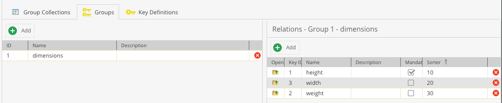
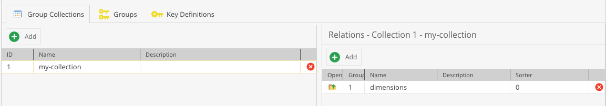
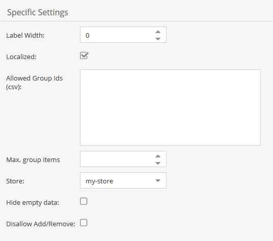
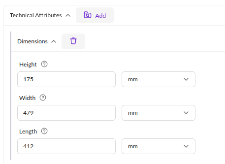
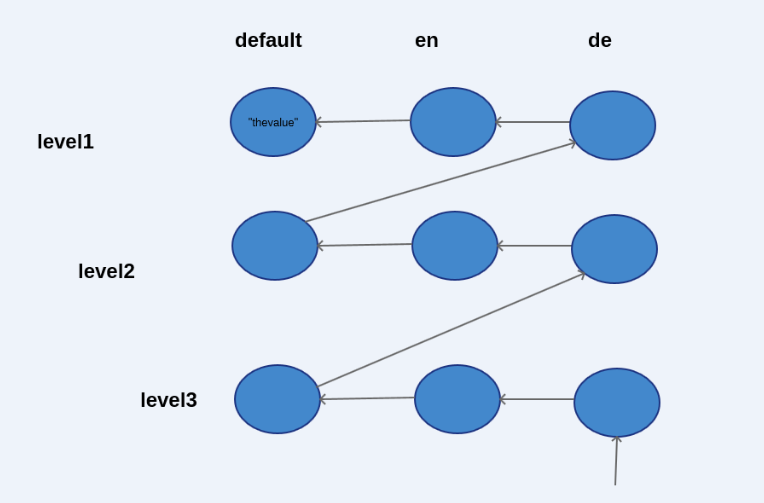

# Classification Store

## Overview

The classification store has quite some similarities to a key/value-like datatype. 

A key/value data type allows to add an arbitrary number of key/value pairs to objects with the restriction that each 
key can only be added once to that object.

#### The most important facts:
* There can be multiple store with completely isolated feature sets.
* Inheritance is supported.
* An object can have more than one classification store.
* Localization is supported and chosen per key; the class definition setting is the default for the keys that do not decide.
* The classification store introduces the concept of a fallback language.
* Which data types a key can use depends on the store's [storage engine](#storage-engines) - every simple data type on both, the structured types that ship a Classification Store marshaller on the EAV engine, and whatever `normalize()` returns, relations included, on the document engine. See [Available Data Types](#available-data-types). The store can be extended with custom data types.
* Takes advantage of the built-in mechanism for the field definition + data editing (validation, etc).
* Keys can be organized in groups.
* A key can belong to several groups.
* Individual keys currently cannot be added to the object. Instead, the corresponding groups added.
* The allowed groups can be restricted via the class definition.


## Available Data Types

A key can use **any registered data type** except eight, and which of the accepted ones a given key
can actually be defined with depends on the [storage engine](#storage-engines) of its store. The
accepted set is not a list anywhere in core: it is every type the object data implementation loader
resolves, minus the eight exclusions, so a type added by a later release or by a bundle is accepted
without core being changed.

### The eight exclusions

Never accepted, on any engine:

| type | why |
|---|---|
| `block`, `objectbricks`, `fieldcollections`, `localizedfields`, `classificationstore` | the five container types. Their value is the values of other field definitions, and a key is one leaf of such a tree rather than a place to hang one. |
| `reverseObjectRelation` | computed from the owning side of a relation rather than stored, so a key has nothing to write. |
| `urlSlug` | its value is a row of the route table `object_url_slugs`, keyed by (object, fieldname), which a key cannot occupy - storing the slug and site id alone registers no route. |
| `calculatedValue` | not part of the set the `document` engine unlocks. Core's existing support for a `calculatedValue` key is untouched: such a key still computes on read and still appears in the object editor, and it is refused neither when it is defined nor when the object is saved. |

### What each engine can hold

| engine | what a key may be |
|---|---|
| `eav` (default, also `NULL`, and what every store uses until it is flipped) | a type whose value fits the two value columns `value` and `value2` (both `LONGTEXT`): every type that normalizes to a scalar - input, textarea, wysiwyg, numeric, slider, checkbox, date, datetime, time, select, country, language, user and so on - plus the types that ship a Classification Store marshaller packing the value into the two columns: `booleanSelect`, `countrymultiselect`, `encryptedField`, `image`, `inputQuantityValue`, `inputQuantityValueRange`, `languagemultiselect`, `multiselect`, `quantityValue`, `quantityValueRange`, `rgbaColor` and `table`. The authoritative list of those marshallers is the `# classification store` section of `bundles/CoreBundle/config/marshaller.yaml`. |
| `document` | every accepted type. A document holds whatever the field definition's `normalize()` returns, so no marshaller is needed and there is no column to pack into - `consent`, `dateRange`, `externalImage`, `geobounds`, `geopoint`, `geopolygon`, `geopolyline`, `hotspotimage`, `imageGallery`, `link`, `numericRange`, `structuredTable` and `video` are storable there and are refused on an `eav` store. |

Defining a key of a type the engine of its store cannot hold is refused with
`Pimcore\Model\DataObject\Exception\UnsupportedEngineFeatureException`, and nothing is written. The
same exception is raised, instead of a value written into a column that cannot hold it, if such a
value reaches the EAV engine anyway - through a key row an upgrade or a direct SQL edit wrote. An
`encryptedField` key is judged by its delegate: its own marshaller encrypts what the delegate's
marshaller packed, so on an `eav` store a delegate with no marshaller leaves it nothing to encrypt
and such a key is refused. On a `document` store the same key works - the value reaches the
encryption as the JSON of what it normalizes to, so the cleartext is never in the document - and a
delegate that normalizes to a scalar, or has a marshaller of its own, is stored exactly as before.

A custom data type is added by registering the data type. On a `document` store that is all; on an
`eav` store it also needs a marshaller under the key `classificationstore_<fieldtype>`, unless its
value is a plain scalar the column already holds.

Each data type also declares how a key of that type can be filtered, through
`Pimcore\Model\DataObject\ClassDefinition\Data::getClassificationStoreKeyFilter()`, which answers a
`Pimcore\Model\DataObject\Classificationstore\KeyFilter`. The declaration is additive - a type that
does not override it declares `KeyFilter::None` - and core ships the declaration alone: it ships no
grid filter and no index mapping for a Classification Store key, because such a value never reaches
`object_query_<CLASS>`. Consuming the declaration is the index side's part.

Relations are **not** supported on an `eav` store, and that is a structural limit rather than a
missing feature: a relation is not stored in a value column at all, but as rows of
`object_relations_*`, which address their owner by field name and owner type (`object`,
`localizedfield`, `fieldcollection`, `objectbrick`). A Classification Store key is none of those -
its values live in the store's own table, keyed by group, key and language - so there is no row a
relation could be written to, and saving such a value is refused with
`Pimcore\Model\DataObject\Exception\UnsupportedEngineFeatureException`. Flip the store to the
`document` engine, or use an [Object Brick](./60_Object_Bricks.md), when the attributes include
relations.

The `document` engine removes that structural limit, because a group's values are one JSON document
and a value is whatever the data type's `normalize()` returns: `manyToOneRelation`,
`manyToManyRelation`, `manyToManyObjectRelation`, `advancedManyToManyRelation` and
`advancedManyToManyObjectRelation` store their element descriptors in the document and resolve them
when the key is read; the per-relation column values of the advanced pair are held in the per-class
table `object_classificationstore_meta_<CLASS>`. The elements are not loaded with the object - a key
is resolved on first read, and a descriptor whose target has been deleted is left out of the value
and taken out of the document on the next save of the object. The opt-in command
`bin/console pimcore:classificationstore:purge-relations` reports such descriptors across an
installation and, with `--force`, removes them.

A `reverseObjectRelation` key is refused on both engines: its value is computed from the objects
pointing at the owner rather than stored on it, so there is nothing for a store to hold.

## Configuration of Classification Stores

Before using the classification store, at least one classification store with collections, groups and keys has to be
defined. 

### Key definition
* Go to classification store in Objects menu:



* Add a new store if necessary
* Add a key
* Select type



* Click on the configuration button on the right for detailed settings
* Note that not all settings are respected (e.g. `indexed`)




### Group definition and key assignment
* Use the group editor to define and organize keys into groups
* Similar to keys a sort order can be specified
* Groups with lower sort order are displayed first
* A key can belong to more than one group
* It is not necessary for the group name to be unique. Note that two entities of the same kind sharing a name within
  one store cannot both be resolved by the identifier backfill described under [Identifiers](#identifiers) - it leaves
  both of them without an identifier and reports them for an operator to resolve
* Use the grid on the right side to manage the keys belonging to the selected group
* Configure sort order for the object editor, keys with lower values are listed first
* Configure which keys should be mandatory in this group



### Collection definition

* Groups can optionally be organized into collections
* A collection is simply a container which allows to add several groups at once, there is no actual logic behind it




## Class definition

* Localization is chosen per key: a key's own `localized` flag decides
  (`Pimcore\Model\DataObject\Classificationstore\KeyConfig::setLocalized()`), and the class definition setting
  here is only the default for the keys that carry none (it is deprecated for that reason). By default no key
  decides and the setting is off, so only the `default` language is available. Because the languages belong to
  the key, the layout the object editor is handed carries each key's effective flag with it: every entry of
  `activeGroupDefinitions[<groupId>]['keys']` has a `localized` boolean beside its `name`, `id`, `description`
  and `definition`. It is answered for every enabled key of an active group, filled or empty, which is what
  lets a client tell a localized key inside a non-localized field from its non-localized siblings
* Allowed groups can be restricted by providing a comma-separated list of group ids
* There can be more than one classification store field 
* Configure the group sort order for the object editor, groups with lower values are listed first
* Optionally you can decide whether you want to see all keys or just the non-empty ones.
* Optionally you can disable add/remove of groups in object editor (in this case, groups can only added and removed via API)
* Optionally you can define a limit of how many groups can be used




## Object editor

* Groups can be added/removed via the add/remove buttons (see screenshot below)
* Keys are displayed in the specified sort order. If the order is equal then the keys are sorted by creation date




## Inheritance

In contrast to localized fields fallback and inherited values are first resolved in a horizontal way. 
If no value can be found on the same level, the parent level is scanned in the same language order. 
As mentioned before, there is the concept of a `default` language which is just an additional pseudo language 
which acts as the last resort.

Consider the following example and let’s assume that English is the fallback language for German. 
We request the German value for the object at level 3. 
Since the only value can be found on level 1 for the default language the tree is traversed as depicted.



## Using Classification Store via PHP API

```php
// setter, group id = 1, key id id = 2, language = de

// the value is of type "quantity value" where 1 is the unit ID in this example
$heightValue = new \Pimcore\Model\DataObject\Data\QuantityValue(13, 1);
$object->getClassificationStore2()->setLocalizedKeyValue(1, 2, $heightValue, "de");
// 1 = group id
$object->getClassificationStore2()->setActiveGroups([1 => true]);
  
// provide additional information about which collection the group belongs to
// group 1 belongs to collection with ID 2
$object->getClassificationStore2()->setGroupCollectionMapping(1, 2);
  
// retrieve the mapping 
// this will return 2 => collection with ID 2
$object->getClassificationStore2()->getGroupCollectionMapping(1);
  
// getter, group id = 1, key id id = 2, language = de
$value = $object->getClassificationStore2()->getLocalizedKeyValue(1, 2, "de");
  
// get the list of active groups
$store = $object->getClassificationStore2();
$groups = $store->getActiveGroups();
  
// get all values as associative array [groupId][keyid][language] => value
$allValues = $store->getItems();
   
```

### Retrieving group and key data

The `ClassificationStore::getGroups()` method returns an array of `Group` objects. In turn, the `Group::getKeys()` method returns an array of `Key` objects for that group.

```php
/** @var \Pimcore\Model\DataObject\Classificationstore $classificationStore */
$classificationStore = $dataObject->get<YOUR_CLASSIFICATION_FIELD>();

foreach ($classificationStore->getGroups() as $group) {
    var_dump($group->getConfiguration()->getName());

    foreach ($group->getKeys() as $key) {
        $keyConfiguration = $key->getConfiguration();

        $value = $key->getValue();
        if ($value instanceof \Pimcore\Model\DataObject\Data\QuantityValue) {
            $value = (string)$value;
        }

        var_dump([
            $keyConfiguration->getId(),
            $keyConfiguration->getType(),
            $keyConfiguration->getName(),
            $keyConfiguration->getTitle(),
            $value,
            ($key->getFieldDefinition() instanceof QuantityValue),
        ]);
    }
}
```

The `Key::getValue()` method supports the `language`, `ignoreFallbackLanguage` and `ignoreDefaultLanguage` arguments.

```php
/** @var \Pimcore\Model\DataObject\Classificationstore\Key $key */
$key->getValue('en_GB', true, true);
```


### Adding new items to Classification Store through code

```php

// KeyConfig

// first of all, define the datatype which is quantity value in this example
$definition = new \Pimcore\Model\DataObject\ClassDefinition\Data\QuantityValue();
$definition->setName("height");
$definition->setTitle("Height");

$keyConfig = new \Pimcore\Model\DataObject\Classificationstore\KeyConfig();
$keyConfig->setStoreId($storeId);
$keyConfig->setName($name);
$keyConfig->setDescription($description);
$keyConfig->setEnabled(true);
$keyConfig->setType($definition->getFieldtype());
$keyConfig->setDefinition(json_encode($definition)); // The definition is used in object editor to render fields
$keyConfig->save();  

// Group
$groupConfig = new \Pimcore\Model\DataObject\Classificationstore\GroupConfig();
$groupConfig->setStoreId($storeId);
$groupConfig->setName($name);
$groupConfig->setDescription($description);
$groupConfig->save();

// Collection
$collectionConfig = new \Pimcore\Model\DataObject\Classificationstore\CollectionConfig();
$collectionConfig->setStoreId($storeId);
$collectionConfig->setName($name);
$collectionConfig->setDescription($description);
$collectionConfig->save();

// Add a key to group
$keyRel = new \Pimcore\Model\DataObject\Classificationstore\KeyGroupRelation();
$keyRel->setGroupId($groupConfig->getId());
$keyRel->setKeyId($keyConfig->getId());
$keyRel->save();

// Add a group to a collection
$groupRel = new \Pimcore\Model\DataObject\Classificationstore\CollectionGroupRelation();
$groupRel->setGroupId($groupConfig->getId());
$groupRel->setColId($collectionConfig->getId());
$groupRel->save();
```

A key carries a title of its own, which the example above does not set: the `title` of the definition it is given
seeds the column instead, as long as the key was neither loaded nor given a title explicitly. `setTitle()` takes
precedence over it, and once a title was set or loaded the definition no longer feeds the column - editing the
definition of a loaded key therefore leaves its title as it was. A save that has neither a loaded nor an explicit
nor a seeded title leaves the stored one alone rather than clearing it, so a key built with `new` to update one
other field does not drop its title.

### Identifiers

Stores, collections, groups and keys carry an `identifier` in addition to their auto increment id and their name.
It is meant as the stable handle for an entity across environments, where the auto increment id is not comparable
and the name is not unique.

* It is **generated** when an entity is created and does not derive from the entity's name, so it stays stable when
  the name is edited. Setting an identifier explicitly before the first `save()` keeps that value instead.
* It is **opaque** - do not parse it, and do not expect it to be readable.
* It is **immutable**: once an entity holds a non-null identifier, `setIdentifier()` refuses to change it and throws
  `Pimcore\Model\Exception\InvalidConfigException`. Setting the same value again is a no-op. The null to value
  transition is enforced in the database as well, so an instance loaded before another process assigned an identifier
  neither clears it on save nor replaces it - the latter is refused with the same exception.
* It is **unique per store** for collections, groups and keys, and unique overall for stores. A save that would write
  an identifier which is already in use within that scope is refused with the same exception, and nothing is written -
  the identifier is never disambiguated with a suffix.
* Valid identifiers match `/\A[A-Za-z0-9][A-Za-z0-9_-]*\z/` and are at most 190 characters long. Anything else is
  rejected by `setIdentifier()`.

```php
$keyConfig = \Pimcore\Model\DataObject\Classificationstore\KeyConfig::getByIdentifier($identifier, $storeId);
$groupConfig = \Pimcore\Model\DataObject\Classificationstore\GroupConfig::getByIdentifier($identifier, $storeId);
$collectionConfig = \Pimcore\Model\DataObject\Classificationstore\CollectionConfig::getByIdentifier($identifier, $storeId);
$storeConfig = \Pimcore\Model\DataObject\Classificationstore\StoreConfig::getByIdentifier($identifier);
```

Each of them returns `null` when nothing matches.

#### Backfilling existing rows

Rows that already existed before the identifier was introduced have none. The console command

```bash
bin/console pimcore:classificationstore:backfill-identifiers
```

assigns an identifier derived from the entity's name to every row across the four tables whose identifier is still
`NULL`, disabled keys included. It writes the `identifier` column and nothing else - no title, modification date or
definition is rewritten - and it is idempotent, so running it twice changes nothing.

A pre-flight runs before anything is written. Rows for which no unique identifier can be derived from the name are
left untouched, listed in the command's report with their type, id, name and the reason, and the command still exits
with `0`. That happens when two entities of the same kind share a name within one store - whether or not the other
one already carries an identifier - when the derived identifier is already taken, or when the name contains no
characters a valid identifier can be built from. Those rows keep a `NULL` identifier until someone renames them and
runs the command again.

Each write is guarded by `identifier IS NULL`, so a row that was given an identifier between the pre-flight and the
write keeps it; the command reports that row as unresolved rather than counting it as backfilled.

### Per assignment fields

Assigning a key to a group is a row of its own, and that row can carry more than the sorter and the mandatory flag.
`Pimcore\Model\DataObject\Classificationstore\KeyGroupRelation` exposes three nullable per assignment fields, all of
which default to "not set" and are written only when they were loaded or explicitly set - a relation built with `new`
that carries just a group id and a key id therefore never clears a stored value.

* `getMetadata()` / `setMetadata()` - an arbitrary JSON object, stored and returned verbatim. Nothing in core reads
  it; the keys `indexed`, `externalCode` and `custom` are conventions for the packages and customer implementations
  that do. The search index mapping, the editor layout and `checkValidity()` behave identically whether or not a
  relation carries metadata.
* `getDefinitionOverride()` / `setDefinitionOverride()` - a partial field definition, in the vocabulary of a key's own
  settings, merged over the key's definition by `getEffectiveDefinition()`.
* `getSubGroup()` / `setSubGroup()` - the sub group of this assignment, naming an entry of the sub group vocabulary
  of the store its group belongs to. `null` means no sub group, and is what clears a stored tag. A save whose value
  names no entry of that vocabulary is refused with `Pimcore\Model\Exception\InvalidConfigException` and writes
  nothing; what is stored is the `identifier` of the entry it resolved to, not the spelling that was passed. The
  vocabulary itself is `Pimcore\Model\DataObject\Classificationstore\SubGroupConfig`, one list per store.

Both JSON fields take and return decoded arrays; the encoding happens in the DAO.

#### Overriding a key's definition per group

`getEffectiveDefinition()` returns the key's definition with the relation's `definitionOverride` merged over it, as
the same JSON string `getDefinition()` returns. With no override stored it returns exactly that definition. Its base
is `getDefinition()` as the instance carries it, which on a relation loaded through `KeyGroupRelation\Listing` already
has the relation's `mandatory` flag folded in and on one loaded through `getByGroupAndKeyId()` does not - `mandatory`
has a column of its own and is not part of an override.

An override may carry `options`, `defaultUnit` and `validUnits`, and nothing else - the per group option subset and
the unit. Any other property is refused by `setDefinitionOverride()` with
`Pimcore\Model\Exception\InvalidConfigException`, and nothing is written. That includes `type` and `fieldtype`,
because an assignment never changes what a key stores, and `title`, `tooltip` and `defaultValue`, which are a
labelling question rather than a definition one.

`options` **filters** rather than replaces: the merged definition keeps the key's own label/value pairs whose value
appears in the override's list, in the key's order. That is what lets one key hold the full option list while each
group uses its own subset of it. `null` means every option, an empty list means none - including for a key whose own
`options` are `null`, where an empty subset still leaves no option at all.

```php
// the sub group has to exist in the vocabulary of the store the group belongs to before it can be named
$subGroup = new \Pimcore\Model\DataObject\Classificationstore\SubGroupConfig();
$subGroup->setStoreId($storeId);
$subGroup->setName('Dimensions');
$subGroup->save();

$relation = \Pimcore\Model\DataObject\Classificationstore\KeyGroupRelation::getByGroupAndKeyId($groupId, $keyId);
$relation->setDefinitionOverride(['options' => ['red', 'green']]);
$relation->setSubGroup($subGroup->getIdentifier());
$relation->save();

$definition = \Pimcore\Model\DataObject\Classificationstore\Service::getFieldDefinitionFromJson(
    json_decode($relation->getEffectiveDefinition(), true),
    $relation->getType()
);
```

> **Note**: `definitionOverride` is stored but not yet read by core. The object editor still renders the key's own
> definition, so saving an override changes nothing that is visible until a reader is wired up.

## Storage engines

Where the values of a store are kept is a property of the store, not of the class. The `engine` column of
`classificationstore_stores` names it, and `NULL` - what every store has until it is changed - means the default
engine.

| engine | storage | tables per class |
|---|---|---|
| `eav` (default, also `NULL`) | one row per key and language | `object_classificationstore_data_<CLASS>`, `object_classificationstore_groups_<CLASS>` |
| `document` | one JSON document per object, field and group | `object_classificationstore_doc_<CLASS>` |

Selecting an engine is opt-in per store and is done from PHP:

```php
$store = \Pimcore\Model\DataObject\Classificationstore\StoreConfig::getByName('myStore');
$store->setEngine('document');
$store->save();
```

A store that already holds values is moved over with the four commands of the next section rather than with the
setter: the setter writes the `engine` column alone, and the tables of the selected engine are created only the next
time a class carrying a classification store field on that store is saved.

The two engines behave the same way through the model API for the values they both hold: `getLocalizedKeyValue()`, the
language fallback, the default-language fallback and inheritance are resolved in PHP at read time and do not depend on
the storage. Deleting a group configuration destroys the stored values of that group on either engine, and deleting an
object removes its values on either engine.

What they do not share is **which key types a store can hold**: that is a property of the engine, and a structured key
that a `document` store takes is refused on an `eav` one - see [Available Data Types](#available-data-types).

There is one deliberate exception. `getGroupCollectionMappings()` lists, on an EAV store, every group holding a
stored value - mapped to `null` when it has no collection - while on a document store it lists only the groups that
have one. `getGroupCollectionMapping($groupId)` answers `null` either way. A `null` entry is not recordable on the
document engine: an object's mappings and its inheritable parent's are merged as an array union, so a `null` on the
child would shadow the parent's collection. Use `getActiveGroups()` to ask which groups hold values.

While a store is being migrated, that difference also moves **within** one store: an object whose values the drain
has not converted yet is still read from the EAV tables and answers the EAV shape, and the same object answers the
document shape once it is converted. Code that reads the full array rather than `getActiveGroups()` therefore sees
the documented difference appear at a moment it cannot predict.

## Migrating a store to the document engine

Four commands move the values a store already holds. They run in this order, and only in this order - there is
**no reverse migration**.

| command | scope | what it does |
|---|---|---|
| `pimcore:classificationstore:flip <store>...` | one store, or the stores sharing a field name | creates the document table of every class carrying a field on those stores, then sets their `engine` to `document` |
| `pimcore:classificationstore:drain [--class=] [--max-divergences=] [--dry-run]` | the classes holding values | converts the EAV rows of one (object, field) pair at a time |
| `pimcore:classificationstore:verify [--class=]` | one class, or every class | recomputes each document's checksum and asserts that no EAV row survived |
| `pimcore:classificationstore:cleanup [--class=] [--dry-run]` | one class, or every class | drops the two EAV tables of a class once every store it uses is converted |

```bash
bin/console pimcore:classificationstore:flip myStore
bin/console pimcore:classificationstore:drain --class=PRODUCT --dry-run
bin/console pimcore:classificationstore:drain --class=PRODUCT
bin/console pimcore:classificationstore:verify --class=PRODUCT
bin/console pimcore:classificationstore:cleanup --class=PRODUCT --dry-run
bin/console pimcore:classificationstore:cleanup --class=PRODUCT
```

`<store>` is a store id or a store name, resolved in that order, and the flip takes more than one of them;
`--class=` is a class **id**. Rolling out per class, smallest class first, is what the drain's own ordering does
when `--class=` is left out.

**The flip takes no engine argument and there is nothing that undoes it.** Every value written to the store after
the flip exists only as a document, so putting the store back on `eav` does not bring those values back - it hides
them behind whatever EAV rows are left. The flip asks for confirmation; `--no-interaction` proceeds without asking.

**The flip creates the document tables first and writes the `engine` column last.** Every other process reads that
column, so a save that saw the switch before the table of its class existed would fail with table-not-found - and a
`CREATE TABLE` that failed half way would otherwise leave the store pointing at tables that are not there. A table
created for a store the command then refuses is an empty table and nothing else.

**Stores sharing a classification store field name have to be flipped together.** A field name identifies a group
of definitions rather than one - two allowed bricks of a class can define the same field on two different stores -
and the value tables key their rows by (object, fieldname), so that group reads and writes one set of rows and
cannot be split across two engines. The flip refuses before it writes anything if it would leave such a group
split, and names the class, the field and the stores that have to come along; pass them all in one invocation:

```bash
bin/console pimcore:classificationstore:flip myStore myOtherStore
```

**Let the writers that predate the flip finish before draining.** Which engine a store resolves to is memoized for
the length of a request or a messenger message, so a process that resolved `eav` before the flip keeps writing EAV
rows until it reaches that boundary. Document reads do not see those rows, and the drain will not delete them: a
pair that holds documents *and* EAV rows is reported as a divergence with its object id and field name, for a human
to reconcile, rather than silently losing the newer values. Draining after the in-flight requests and messages have
finished is what avoids that report.

**Reads and writes keep working throughout.** Between the flip and the drain the values of a (object, field) pair
are read through to the EAV tables, so nothing goes missing and nothing is merged: a pair that holds no document at
all is answered from the EAV rows, a pair that holds at least one document from the document alone. The values are
derived at read time; no column records which of the two answered. An ordinary save writes the pair's documents and
deletes that pair's rows from both EAV tables in the same transaction, so an object a user saves while the drain is
running is converted by that save. A drain the user save got to first writes nothing over it. An unchanged save
still writes nothing at all - a pair whose documents are already what the save wants has no EAV rows left to take.
Deleting an object's classification store values takes both sides in one transaction as well, so a pair the drain
has not reached is not served again by the read-through afterwards. Which of the two sources answers a load, and
what it answers with, are decided in one snapshot, so a load that runs while a pair is being converted sees the
pair either wholly on EAV or wholly on documents and never between the two.

**The drain is one transaction per (object, field) pair.** Per pair it reads the EAV side with inheritance off,
writes the documents if the pair holds none, reads them back, compares the two and only then removes the pair's EAV
rows. A pair that does not compare equal is a divergence: its document is rolled back, its EAV rows are left in
place, it is reported with its object id and field name, and the class stops once `--max-divergences` (default: 1)
is reached - while the next class carries on. **The command exits non-zero when any pair is left on EAV**, which a
divergence and a stopped class both are. There is no cursor: a re-run reads its backlog from the EAV rows that are
left.

The pair the drain locks first is the object's row, which is the lock an ordinary save takes first as well, so a
save and a drain of the same object queue on each other rather than deadlocking on opposite orders. What it reads
up front is one pending-pair count per class - that is the order the run goes in, smallest class first - and the
pairs of a class are then read from its value tables a bounded batch at a time, so the backlog of an installation
is never held in the process at once. The objects it loads are not held either: converting a pair loads its object,
and the runtime cache is cleared every hundred pairs so that a run does not grow by the objects behind it. A
converted object is also dropped from the runtime cache and has its cache entry invalidated as its pair commits,
the way a save of the same rows would: an entry written before the conversion carries the values of the side the
pair has left, and a group mapped to no collection is the one thing the two sides do not read the same way - so a
cached parent holding such a mapping would answer a child's inherited collection with it. The
progress bar of `--processes` therefore has no total; the `n of m pair(s) converted` line the drain prints does,
from those counts.

While it runs the drain reports the pairs it converted, the time that took, the rate that works out to and how long
the rest would take at that rate, so "how long for millions of values" is answered from the installation's own
hardware rather than from a figure of ours. `--dry-run` reports the backlog of every class and converts nothing.
Without `--processes` the drain runs in the main process, because the divergence threshold is per class and has to
be counted in one place; `--processes` trades that for throughput and counts the threshold per worker. The totals
of the run and its exit code do not depend on that choice: what a pair became is counted in the process that
converted it, so the figures at the end are read back from the backlog the conversions emptied rather than from
counters a worker holds. Batching, throttling and the run lock come from
`Pimcore\Console\Traits\Parallelization`.

**Every document row carries a `sha1` of its `values` column in `checksum`**, written by the drain and by an
ordinary save alike. `migratedAt` is written by the drain alone, so a document with no `migratedAt` was created by a
user save. `verify` recomputes each checksum and reports every row that does not match, plus every pair that still
holds EAV rows, and exits non-zero if there is one; a row written before this release carries neither stamp and is
reported as unproven rather than as corrupt. The `values` column holds everything one group of one object stores,
so the check walks the document table along its primary key a batch at a time rather than reading it in one query -
its memory is bounded by one batch however much the class holds, and `cleanup`, which re-runs the check inline, is
bounded by the same. What it finds it writes as it finds it; the report it hands back carries the counts alone, so a
store whose every row is unproven does not have to fit in the process either.

**`cleanup` is per class while the flip is per store.** It drops the two EAV tables of a class only when every store
used by any classification store field on that class resolves to `document` and the verification of that class
holds. When it refuses, it names the stores that are in the way by id and by name - a class carrying a second field
on a store nobody has flipped keeps its tables. The `DROP` waits for the read-throughs that are still in flight: a
read-through holds the metadata locks of both EAV tables for the length of its transaction, so a load that has
chosen those rows as its source reads them before they go rather than finding them gone mid-load. Read-throughs
that start while that `DROP` is waiting queue behind it, which by then is a drop of two empty tables. A load whose
tables did go first - because it had not reached them yet - answers from the documents, which is where a class
whose tables are gone holds all of its values.

#### What the document engine does and does not do

* A save writes only the groups whose document changed. An unchanged save writes nothing, and changing a value in
  one group does not rewrite the documents of the other groups.
* Within a group, the document **is** the group: changing one value rewrites that group's whole document in one
  statement. Fewer statements than the EAV engine, more bytes per statement - measure a store with large groups
  before switching it.
* A group that is active but holds no value is stored as the document `{}`. The presence of the row is what makes
  the group active; there is no second table.
* It offers exactly one capability the EAV engine does not: `supports()` answers `true` for
  `Pimcore\Model\DataObject\Classificationstore\Engine\EngineFeature::StructuredValues` and `false` for
  `MultiValue`, `Variants` and `Relations`. That capability is what widens the key types a store can hold - see
  [Available Data Types](#available-data-types). It also answers `true` for `PerKeyLocalization`, but that one
  both engines serve, as it is a property of the key configuration rather than of the storage. Nothing in the
  object editor or Studio selects the engine yet.
* Values are stored as the field definition's `normalize()` output. An `encryptedField` key is the one exception:
  it keeps its classification store marshaller, which encrypts the value, so the cleartext is never in the
  document. That encryption draws a fresh salt per call, so a value whose cleartext did not change keeps the
  ciphertext the document already holds - otherwise every save would rewrite every group holding a secret. A value
  that did change is encrypted anew.

After changing an `engine` value by hand, run

```bash
bin/console pimcore:classificationstore:check-engines
```

which lists every store that does not resolve to a registered engine and exits non-zero if there is one.
