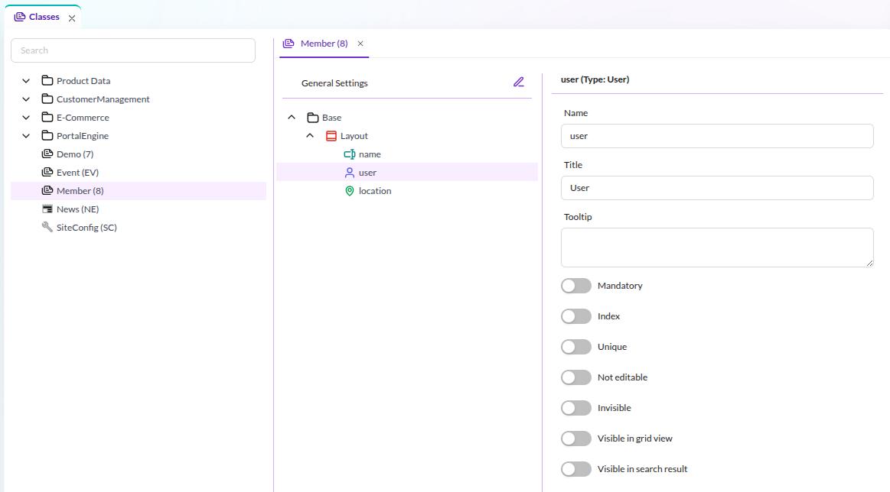
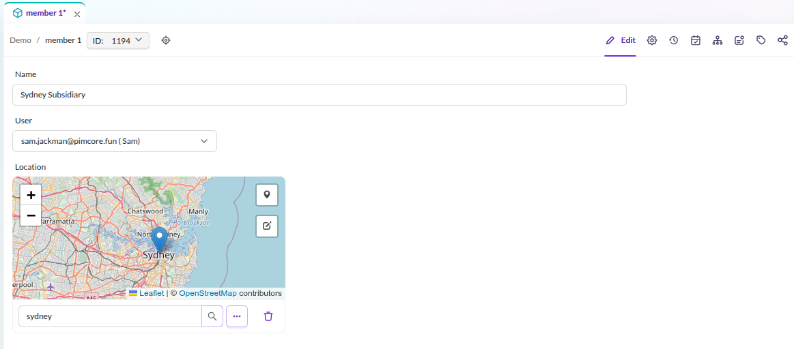
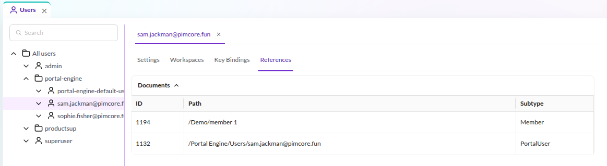

# Extending the Pimcore User

Pimcore does not support extending the user directly. Instead it allows creating a relation
between a user and one or more Pimcore objects. This can add information to a user
or associate one or more objects directly with a system user.

This article presents an example where the `member` object is associated with a Pimcore user.
The screenshots show how to achieve this through Pimcore Studio. Further below
is an example of how to create and associate user and member objects programmatically.

Regardless of the creation method, define the member class first in
the class editor in Pimcore Studio 
(`Data Management` -> `Data Model Definitions` -> `Classes`).



In this example, the class `member` has the three properties `name`, `user` and `location`. 
The class can have an arbitrary number of properties. What is important in this context is, 
that it has a property of the type `User`. Speaking in code this would be a 
`\Pimcore\Model\DataObject\ClassDefinition\Data\User`.

When creating the first object instance of the member class, you can see the input widget 
for the user property. It is a combo box where a user can be selected from all available 
Pimcore users.



In this example the user "sam jackman" was selected.

In Pimcore Studio (`System` -> `User & Roles` -> `Users`) this relation appears in the third tab of each
user, labeled `This user is referenced in the following objects:`



Objects and users are not necessarily always created through user input in Pimcore Studio.
Sometimes these objects are created programmatically in the context of importers. The 
following code snippet shows how to first create the user and then the member object with 
the relation to the previously created user:

```php
use Pimcore\Model\User;
use Pimcore\Model\DataObject;
...
 
//create a new user for Sydney
$user = User::create([
    "parentId" => (int) $userGroup->getId(),
    "username" => "sydney",
    "password" => "password1234",
    "hasCredentials" => true,
    "active" => true
]);
 
...
 
//create the Sydney member object
$object = new DataObject\Member();
$object->setCreationDate(time());
$object->setUserOwner($currentUser->getId());
$object->setUserModification($currentUser->getId());
$object->setPublished(true);
 
$object->setName("Sydney Subsidiary");
$object->setKey("member1234");
//select the user belonging to this object
$object->setUser($user->getId());
 
$object->setParentId($parentFolderId);
$object->save();
 
...
```

Aside from creating these objects, one might need to find out what objects are associated with a certain user. 
There is a convenient method available to find all objects associated with a specific user:

```php
$objects = \Pimcore\Model\DataObject\Service::getObjectsReferencingUser($userId);
```

## User Types: Users and Service Users

The users table stores every identity, selected by its `type`:

- `user`: a `Pimcore\Model\User`, a person who logs in with a password.
- `serviceuser`: also a `Pimcore\Model\User`, with `isServiceUser()` true: a machine identity for an integration, agent
  or pipeline. There is no separate class, and `User` stays `final`.

A service user is a Pimcore user for everything that authorizes it: it has roles, workspaces, permissions,
class and document type restrictions, and MCP server access, just like a person. It differs in what it cannot do:

- It never gets a password from a caller: `setPassword()` with a value throws, and every save stores a new unusable
  random value that no password verifies against, as for users created through OpenID Connect. It is never an
  administrator and has no two-factor authentication.
- It cannot log in interactively, a session never carries it, and a password recovery never reaches it.
- It is not counted or listed as a person.
- The type of a saved user never changes: a person does not become a service user, nor the reverse.

```php
use Pimcore\Model\User;

$serviceUser = User::createServiceUser([
    'name' => 'svc-erp-import',
    'active' => true,
]);

$serviceUser = User::getServiceUserByName('svc-erp-import'); // null if there is none
$serviceUser->isServiceUser(); // true
```

Lookups keep the two kinds apart:

- `User::getByName()` and `Pimcore\Model\User\Listing` return persons only. Code that lists people, for example
  notification recipients or a user picker, does not see service users.
- `User::getServiceUserByName()` and `Pimcore\Model\User\ServiceUser\Listing` (`getServiceUsers()`) return service users only.
- `User::getById()` returns the user for either kind. Call `isServiceUser()` when the caller needs to know which one it got.

Names are unique across both types: saving a user or service user with a name that the other type already uses throws
`Pimcore\Model\User\Exception\DuplicateUserNameException`. Service users are not converted from users and users are not
converted from service users. To give a service user the access of a person, copy its roles and workspaces to a new
service user.
